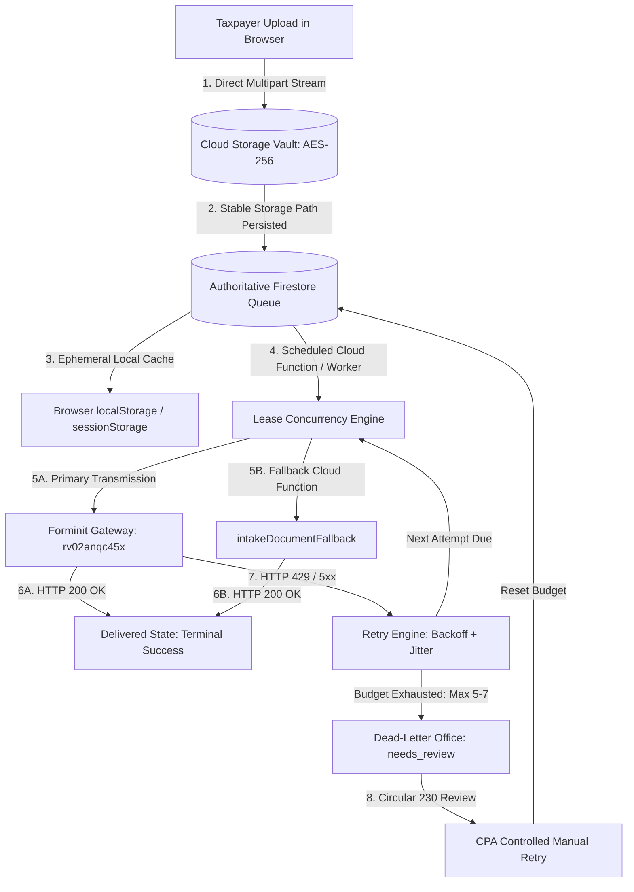

# Durable Document Delivery Queue Architecture & Runbook
**The File Room by Pivot Aide Tax**  
*Statutory Compliance: FTC Safeguards Rule (16 CFR Part 314 § 314.4) · IRC § 7216 · IRC § 6061 · IRS Pub 1345 · Treasury Circular 230 § 10.22*

---

## 1. Executive Summary & Architecture Overview

The **Durable Document Delivery Queue (DDQ)** is the authoritative, fault-tolerant transmission subsystem responsible for ingesting, vaulting, and downstream-delivering regulated taxpayer documents (Form W-2, 1099, Closing Disclosures, Form 8879 signatures) between The File Room client portal and external tax filing/intake endpoints (e.g., Forminit, IRS MeF gateways, and CPA review pipelines).

### Core Architectural Invariants



1. **Authoritative State & Queue Store**: Cloud Firestore collection `document_delivery_queue` (and `delivery_queue`) is the sole authoritative state machine and transmission ledger.
2. **Authoritative Document Custody**: Cloud Storage (`gs://uk-client-d90d5.appspot.com/clients/{uid}/...` and `intake_submissions/{uid}/...`) is the authoritative repository of record under AES-256 encryption. A stable storage path reference MUST be recorded before queuing downstream delivery.
3. **Bounded Retries & Dead-Letter Handling**: Scheduled Cloud Functions (`processDeliveryQueue`, running every 5 minutes via Cloud Scheduler) and Cloud Tasks execute bounded retries with exponential backoff, randomized jitter, and HTTP 429 `Retry-After` parsing.
4. **Temporary Client-Side Recovery Aid Only**: Browser `localStorage` and `sessionStorage` serve strictly as ephemeral crash-recovery aids (e.g. buffering intent across tab crashes). **Never claim zero data loss solely because localStorage is enabled.** LocalStorage is unencrypted at rest, browser-clearing prone, and never authoritative.
5. **Distributed Worker Concurrency**: Workers acquire transactional leases via `db.runTransaction` with UUID lease tokens and TTL expiration timestamps. Multiple workers cannot process the same job concurrently, and orphaned leases from crashed workers are reclaimed automatically.
6. **Strict Idempotency**: Deduplication via deterministic keys (`ik_ddq_{clientId}_{documentId}_{checksumPrefix}`) guarantees that retries, network flushes, or duplicate user submissions never create duplicate document records or duplicate logical submissions.
7. **Statutory Retention Custody Holds**: Under IRC § 6061 and IRS Pub 1345, documents cannot be purged from Cloud Storage while in active queue delivery states (`uploaded`, `queued`, `processing`, `retry_pending`, `needs_review`).

---

## 2. Explicit State Machine Specification

The delivery queue operates as a deterministic, finite state machine with seven explicit states:

| State | Category | Description | Permitted Next States |
| :--- | :--- | :--- | :--- |
| `uploaded` | In-Flight | Document bytes securely vaulted in Cloud Storage; storage reference confirmed. | `queued`, `permanently_failed` |
| `queued` | In-Flight | Registered in authoritative Firestore queue; awaiting worker dispatch. | `processing`, `permanently_failed`, `needs_review` |
| `processing` | Active Lease | Worker acquired transactional lease with active TTL token; transmission underway. | `delivered`, `retry_pending`, `permanently_failed`, `needs_review` |
| `delivered` | Terminal Success | Downstream HTTP 200/201 confirmed with transmission receipt; queue lease released. | None (Terminal) |
| `retry_pending` | Transient Wait | Transient failure (HTTP 429/5xx/timeout); awaiting exponential backoff timer. | `processing`, `needs_review`, `permanently_failed` |
| `permanently_failed`| Terminal Error | Non-retryable error (HTTP 400 bad request, schema error); fast-failed. | `queued` (Controlled CPA Manual Retry only) |
| `needs_review` | Dead-Letter Office| Retry budget exhausted or manual hold; requires CPA practitioner review. | `queued` (Controlled CPA Manual Retry only) |

### State Transition Validation Table

```
From / To          uploaded  queued  processing  delivered  retry_pending  permanently_failed  needs_review
uploaded              —        YES       NO          NO           NO              YES              NO
queued                NO        —        YES         NO           NO              YES              YES
processing            NO        NO        —          YES          YES             YES              YES
delivered             NO        NO        NO          —           NO               NO               NO
retry_pending         NO        NO       YES         NO            —              YES              YES
permanently_failed    NO       YES*       NO         NO           NO               —               NO
needs_review          NO       YES*       NO         NO           NO              YES               —
```
*\*Only permitted when authorized CPA firm staff executes a Controlled Manual Retry.*

---

## 3. Mandatory Metadata Schema

Every record in `document_delivery_queue` conforms to the following strict schema:

```typescript
interface DocumentDeliveryJob {
  // Identifiers & Deduplication
  jobId: string;                    // e.g. "ddq_usr_whitfield_4417_req_w2_2026_e3b0c4"
  idempotencyKey: string;           // e.g. "ik_ddq_usr_whitfield_4417_req_w2_2026_e3b0c4"
  documentId: string;               // Client document identifier
  requestId: string;                // Firm document checklist request ID
  clientId: string;                 // Client UID (Tenant Isolation Boundary)
  clientEmail: string;              // Taxpayer notification address
  taxYear: number;                  // e.g. 2026

  // File & Storage Custody Reference
  fileName: string;                 // Sanitized file name
  fileSizeBytes: number;            // Size in bytes
  mimeType: string;                 // Validated MIME type (application/pdf, image/png)
  detectedType: string;             // e.g. "W-2 Wage Statement"
  storagePath: string;              // "clients/{uid}/documents/..."
  fileStorageUri: string;           // "gs://uk-client-d90d5.appspot.com/..."
  downloadUrl?: string;             // Signed/authorized download URL
  sha256Checksum: string;           // Hex-encoded SHA-256 file digest

  // Queue State Machine & Retries
  status: 'uploaded' | 'queued' | 'processing' | 'delivered' | 'retry_pending' | 'permanently_failed' | 'needs_review';
  attemptCount: number;             // 0-based initial; increments on each attempt
  maxAttempts: number;              // Bounded retry ceiling (default: 5, scheduler: 7)
  nextAttemptAt: string | null;     // ISO 8601 timestamp for next scheduled attempt
  lastAttemptAt: string | null;     // ISO 8601 timestamp of most recent dispatch
  createdAt: string;                // ISO 8601 creation timestamp
  updatedAt: string;                // ISO 8601 last modification timestamp
  deliveredAt: string | null;       // ISO 8601 timestamp of downstream confirmation

  // Error Classification & Dead-Letter Metadata
  lastErrorCategory: string | null; // e.g. "RATE_LIMIT_429", "SERVER_ERROR_5XX", "RETRIES_EXHAUSTED"
  lastErrorMessage: string | null;  // Redacted error message (secrets stripped)
  lastHttpStatus: number | null;    // HTTP response status code (e.g. 429, 503)
  manualReviewRequired?: boolean;   // Flagged for CPA review in Dead-Letter Office
  manualReviewNotes?: string | null;// Practitioner review notes

  // Distributed Concurrency Lease
  leaseOwner: string | null;        // Worker instance identifier
  leaseToken: string | null;        // UUID lease token for compare-and-swap
  leaseExpiresAt: string | null;    // ISO 8601 lease expiration timestamp (TTL)

  // Downstream Receipt & History Trail
  downstreamEndpoint: string;       // Forminit endpoint or fallback URL
  deliveryReceipt: string | null;   // Downstream acknowledgment receipt ID
  history: Array<{
    attempt: number | string;
    timestamp: string;
    status: string;
    category?: string;
    httpStatus?: number;
    delayMs?: number;
    receipt?: string;
    actor?: string;
    note: string;
  }>;
}
```

---

## 4. Retry Policy: Bounded Backoff with Jitter & Error Classification

### Exponential Backoff Algorithm with Randomized Jitter
To prevent synchronous "thundering herd" spikes against downstream receivers during network recoveries, the delay interval is computed as:

$$\text{delay} = \min\left(\text{maxDelay},\; \text{baseDelay} \times 2^{\text{attempt} - 1}\right) \pm \left(\text{random} \times \text{jitterFactor} \times \text{delay}\right)$$

Where:
- $\text{baseDelay} = 1{,}000\text{ ms}$ (Cloud Function scheduler: $30{,}000\text{ ms}$)
- $\text{maxDelay} = 300{,}000\text{ ms}$ (5 minutes; maximum scheduler ceiling: 4 hours)
- $\text{jitterFactor} = \pm 25\%$ randomized variance
- $\text{attempt} \ge 1$

### HTTP 429 Rate-Limit Handling (`Retry-After`)
When an endpoint responds with HTTP 429 (Too Many Requests), the engine checks for the standard `Retry-After` header:
- **Integer Value**: Interpreted as delay in seconds and converted to milliseconds.
- **HTTP Date String (RFC 1123)**: Parsed and converted to relative milliseconds from `Date.now()`.
- If missing or unparseable, standard exponential backoff with jitter is applied.

### Error Classification Matrix

| HTTP Status / Condition | Error Category | Retryable? | Action |
| :--- | :--- | :--- | :--- |
| **HTTP 429** | `RATE_LIMIT_429` | **Yes** | Schedule retry respecting `Retry-After` header + jitter. |
| **HTTP 500, 502, 503, 504** | `SERVER_ERROR_5XX` | **Yes** | Schedule retry with exponential backoff + jitter. |
| **Socket Timeout / ETIMEDOUT**| `NETWORK_TIMEOUT` | **Yes** | Schedule retry with exponential backoff + jitter. |
| **HTTP 400, 401, 403, 404, 422**| `CLIENT_ERROR_4XX` | **No** | Fast fail to `permanently_failed` without wasting retry budget. |
| **Malformed PDF / Bad Checksum**| `SCHEMA_VALIDATION_ERROR`| **No** | Fast fail to `permanently_failed`; alert client to re-upload. |
| **Attempt Count $\ge$ Max Budget**| `RETRIES_EXHAUSTED` | **No** | Transition to `needs_review` (Dead-Letter Office); audit alert. |

---

## 5. Distributed Concurrency & Worker Lease Mechanics

### Problem Statement
In a horizontally scaled environment (multiple Cloud Function instances, Cloud Tasks, and browser background pollers), multiple workers must never process the same queue record simultaneously. Doing so could cause duplicate downstream transmissions, double-billing, or race conditions.

### Transactional Lease Protocol (`acquireLease`)
Workers acquire an exclusive processing lease atomically via Firestore transaction:

```javascript
await db.runTransaction(async (transaction) => {
  const doc = await transaction.get(docRef);
  const data = doc.data();

  // Condition: Must be in queued/retry_pending AND nextAttemptAt <= now
  // OR currently processing with an EXPIRED lease TTL
  const isReady = (data.status === 'queued' || data.status === 'retry_pending');
  const isDue = !data.nextAttemptAt || Date.parse(data.nextAttemptAt) <= Date.now();
  const isLeaseExpired = (data.status === 'processing' && data.leaseExpiresAt && Date.parse(data.leaseExpiresAt) < Date.now());

  if (!((isReady && isDue) || isLeaseExpired)) {
    return { acquired: false, reason: 'Job not eligible or active lease held' };
  }

  const updates = {
    status: 'processing',
    attemptCount: (data.attemptCount || 0) + 1,
    leaseOwner: workerId,
    leaseToken: crypto.randomUUID(),
    leaseExpiresAt: new Date(Date.now() + 60000).toISOString(), // 60s lease TTL
    lastAttemptAt: new Date().toISOString(),
    updatedAt: new Date().toISOString()
  };
  transaction.update(docRef, updates);
  return { acquired: true, job: { ...data, ...updates } };
});
```

### Crash Recovery & Orphaned Lease Reclamation
If Worker 1 crashes (e.g., node out-of-memory or VM preemption) after acquiring a lease, the job remains in `processing` until `leaseExpiresAt` is reached (60 seconds).
On the subsequent scheduler sweep, Worker 2 detects that `leaseExpiresAt < Date.now()`, reclaims the orphaned job atomically, increments the attempt counter, and completes downstream delivery.

---

## 6. Dead-Letter Office (DLO) & Controlled Manual Recovery

### Exhaustion Trigger
When transient failures persist and `attemptCount >= maxAttempts`, the job is not dropped or permanently discarded. It transitions to `needs_review` (The Dead-Letter Office) with `manualReviewRequired: true`.

An immutable WORM audit event is logged under IRC § 7216:
```json
{
  "eventType": "DOCUMENT_DELIVERY_DEAD_LETTERED",
  "actor": { "uid": "worker_scheduler", "role": "system_worker" },
  "targetId": "ddq_whitfield_w2_01",
  "targetType": "DocumentDeliveryQueue",
  "summary": "Document delivery retry budget exhausted (5/5). Transferred to Dead-Letter Office.",
  "metadata": { "jobId": "ddq_whitfield_w2_01", "attemptCount": 5, "lastError": "504 Gateway Timeout" }
}
```

### Controlled Manual Retry (Treasury Circular 230 § 10.22)
Taxpayers and unauthorized clients CANNOT self-clear dead-lettered jobs (enforced by Firestore rules `allow update: if isFirmStaff()`).
Authorized CPA practitioners triage the Dead-Letter Office in the Firm Dashboard (`firm/delivery-queue.html`), verify downstream endpoint connectivity, and authorize a controlled manual retry:

1. **Attempt Count Reset**: `attemptCount` is reset to 0.
2. **Immediate Dispatch**: `nextAttemptAt` is set to `now`.
3. **Lease Clear**: Any stale lease ownership is purged.
4. **Audit Trail**: Action is recorded with practitioner name, timestamp, and review rationale.

---

## 7. Client-Side Ephemeral Storage & Transparency

### Ephemeral Storage Disclaimer (Statutory Safeguard)
```
Browser localStorage / sessionStorage is an ephemeral, unencrypted client-side crash-recovery aid only.
It is NEVER treated as encrypted storage or the authoritative copy of a taxpayer document.
Zero data loss is NEVER claimed solely because localStorage is enabled.
```

- Taxpayer documents are encrypted at rest only within authorized Cloud Storage.
- `sessionStorage` buffers transmission intent only while the user's browser session is active.
- As soon as Firestore confirms receipt of the queue job, the ephemeral recovery aid is deleted.

### Client-Side Dual-State User Feedback
Taxpayers often panic and duplicate submissions when an endpoint experiences transient rate limiting. The File Room UI explicitly decouples and distinguishes:

1. **Storage Vault Custody**: `✓ Vaulted in Cloud Storage (AES-256 Custody Established)`
2. **Downstream Transmission**: `⏳ Queued for Downstream Delivery` or `↻ Temporary Network Delay — Retrying Automatically (Attempt 2/5)`

Even if downstream endpoints are temporarily offline, the taxpayer is assured that their document is securely retained in firm custody and does not need to be re-uploaded.

---

## 8. Verification & Test Suite Results

The architecture is validated by two automated test suites covering all statutory and operational requirements:

### Test Suite 1: Core Queue Engine (`functions/test/document-delivery-queue.test.js`)
- `1. Explicit States`: All 7 required states and transition validations (PASS)
- `2. Mandatory Metadata`: Schema fields, attempt count, timestamps (PASS)
- `3. Exponential Backoff with Jitter`: Formula, variance, Retry-After header (PASS)
- `4. Dead-Letter Office`: Transition to `needs_review` upon budget exhaustion (PASS)
- `5. Distributed Concurrency`: Exclusive worker leases, collision prevention (PASS)
- `6. Idempotency`: Zero duplicate Firestore documents on duplicate enqueues (PASS)
- `7. Storage Retention Hold`: Deletion prohibited while in delivery pipeline (PASS)
- `8. Controlled Manual Retry`: Authorized CPA retry, budget reset, audit logging (PASS)
- `9. Temporary Storage Disclaimer`: Disclaim zero data loss solely via localStorage (PASS)
- `10. End-to-End Scenarios`: Transient 429 followed by 200 OK delivery confirmation (PASS)

### Test Suite 2: End-to-End Failure & Recovery (`tests/document-delivery-queue-e2e.test.mjs`)
- `Scenario 1: Browser Closure`: Complete memory/storage wipe; authoritative Firestore recovery (PASS)
- `Scenario 2: Offline Mode`: Local intent buffer, network reconnection, queue flush (PASS)
- `Scenario 3: Worker Restart & Crash`: Orphaned lease TTL expiration and safe reclamation (PASS)
- `Scenario 4: Duplicate Events & Idempotency`: Multiple submissions yield 1 record (PASS)
- `Scenario 5: Exhausted Retries`: 4 persistent 503s transition to `needs_review` with audit log (PASS)
- `Scenario 6: Controlled Manual Recovery`: 403 on client retry, CPA authorization, reset & delivery (PASS)

---

## 9. Deployment Runbook & Commands

### Prerequisites
- Node.js 20+ runtime
- Firebase CLI (`npm install -g firebase-tools`)
- Google Cloud Project: `uk-client-d90d5`

### 1. Deploy Firestore Security Rules
```bash
firebase deploy --only firestore:rules
```
*Enforces tenant isolation, client create constraints (`status == 'queued'`, `attemptCount == 0`), staff-only updates, and forbidden hard deletes.*

### 2. Deploy Firestore Composite Indexes
```bash
firebase deploy --only firestore:indexes
```
*Deploys composite indexes for `document_delivery_queue` and `delivery_queue` covering status, nextAttemptAt, clientId, and leaseExpiresAt.*

### 3. Deploy Cloud Functions & Scheduler Trigger
```bash
firebase deploy --only functions:processDeliveryQueue,functions:intakeDocumentFallback
```
*Deploys the 5-minute scheduled queue worker and the zero-RAM streaming intake fallback gateway.*

### 4. Deploy Storage Security Rules
```bash
firebase deploy --only storage:rules
```
*Enforces 25MB statutory limits, magic bytes MIME constraints, and firm staff custody retention.*

### 5. Verify Scheduled Function Health
```bash
gcloud functions logs read processDeliveryQueue --region=us-central1 --limit=50
```
Expected output:
```
[processDeliveryQueue] Starting sweep at 2026-10-15T16:50:00.000Z
[processDeliveryQueue] Processing 3 record(s)
[processDeliveryQueue] Delivered via Forminit: ddq_whitfield_w2_01
[processDeliveryQueue] Done. succeeded=3 failed=0
```
